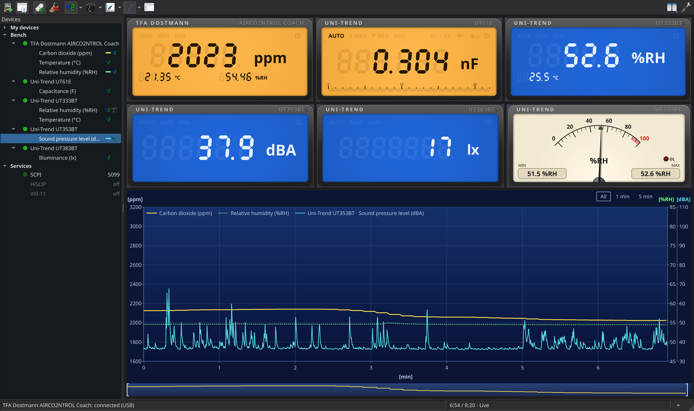

| Build               | Status |
| ------------------- | ------ |
| Windows             |  |
| macOS               |  |
| FreeBSD             |  |
| Flatpak             |  |
| Nix                 |  |
| Fedora Copr master  |  |
| Fedora Copr release |  |
| openSUSE (OBS)      |  |

# QtDMM

**QtDMM** is a cross-platform digital multimeter (DMM) readout application
with a built-in, configurable transient recorder. It's especially useful for users
of older multimeters whose original software no longer runs on modern operating
systems.

QtDMM provides a reliable, open-source alternative to outdated or proprietary DMM
software and runs on current **Linux**, **Windows**, **macOS** and **FreeBSD**
systems.

Website with downloads and the online handbook: **<https://qtdmm.de>**,
contact: <hello@qtdmm.de>.
Source code and bug reports: <https://github.com/qtdmm/QtDMM>.

## Features

- Transient Recorder
  - Manual start
  - Scheduled start at a specific time
  - Automatic start triggered when defined thresholds are reached
- Needle meter display with auto-ranging scale; display, meter, graph and readings table arranged automatically or freely
- Alarms: banner, beep, popup, program or recorder start/stop when the reading leaves its range, stays there for a while, overloads or stops coming (see [Alarms](user/alarms.md))
- Export as CSV, Excel (.xlsx) or OpenDocument (.ods) - recorder and readings table
- Export the graph as SVG, PDF, PNG or JPEG - vector output for documents and the web
- Readings table: every value the meter sent, with time, mode and range; copy to a spreadsheet or export (see [Readings table](user/readings-table.md))
- Several meters at once, one window each, recording in sync
- Calculated values across meters (power from voltage and current, ...)
- SCPI server: the meter answers `*IDN?` and `READ?` on a TCP port for lxi-tools, Python or LabVIEW, announced by mDNS (see [SCPI server](user/scpi-server.md))
- Simulated meter (sine, square, noise, discharge curve, ...) for demos and testing
- various connection backends
  - RS232 Serial (USB-Serial and native UART)
  - USB HID-serial support (HOITEK HE2325U & compatible)
  - RFC2217 remote serial, with **qtdmm-bridge** to serve serial and HID meters from a Raspberry Pi, found by mDNS (see [Meters over the network](user/remote-bridge.md))
  - Sigrok support via sigrok-cli application - Keysight, Agilent, HP and Siglent SCPI bench meters are in the model list (see [Bench meters](user/bench-meters.md))
  - Bluetooth LE: the UNI-T UT60BT (and the UT61B+/D+/E+ with the UT-D07B adapter) over a Bluetooth connection, and Victron SmartShunt / BMV-712, SmartSolar / BlueSolar MPPT and Phoenix Inverter Smart over their encrypted "Instant Readout" broadcasts (see [Bluetooth LE](user/bluetooth.md))
- supports lots of DMMs, see [Supported devices](user/supported-devices.md)
  - custom serial settings dialog for yet unknown DMMs

## Key Advantages

- Supports many RS232-based/USB-based multimeters
- Recording via network remote with RFC2217 remote serial support
- Runs several meters side by side and combines them (power from U and I)
- No proprietary software required
- Fully **open source**, licensed under the GPL version 3 or later
- Easy to use and extend

## Documentation

- **[User Guide](user/index.md)** — connecting a meter, the recorder, CSV
  export, troubleshooting, keyboard shortcuts. The same pages are built into
  QtDMM as its handbook (F1).
- **[Protocols](protocols/index.md)** — the wire protocols of the supported
  meters: which decoder handles which device, the original protocol notes and
  captures, and the test vectors derived from them.
- **[Development](dev/index.md)** — building, testing, and extending QtDMM,
  including how to add support for a new meter; the Doxygen API
  documentation is at <https://qtdmm.github.io/QtDMM/api/>.
- **[Contributing](https://github.com/qtdmm/QtDMM/blob/master/CONTRIBUTING.md)** —
  reporting a bug or a meter, capturing a meter's frames, translations and
  pull requests.

This site is published at <https://qtdmm.de/docs/>. Build it locally with
`pip install mkdocs` and `mkdocs serve` from the repository root.

## Licensing

- **0.9.5 until today tuxmaster and various contributors, see AUTHORS file**
- **0.9.3 and before (c) 2001-2016 M.Toussaint <qtdmm@mtoussaint.de>**

QtDMM 0.9.0 and beyond is distributed under the GNU General Public License,
version 3 or (at your option) any later version. Versions before 0.9.0 are
licensed under the GNU GPL version 2 or later.
